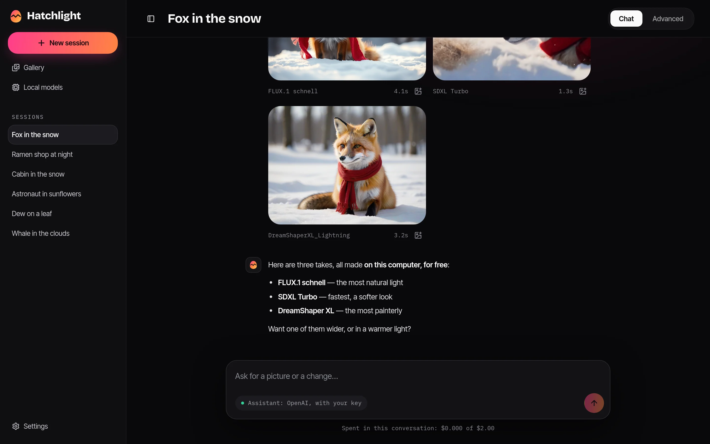
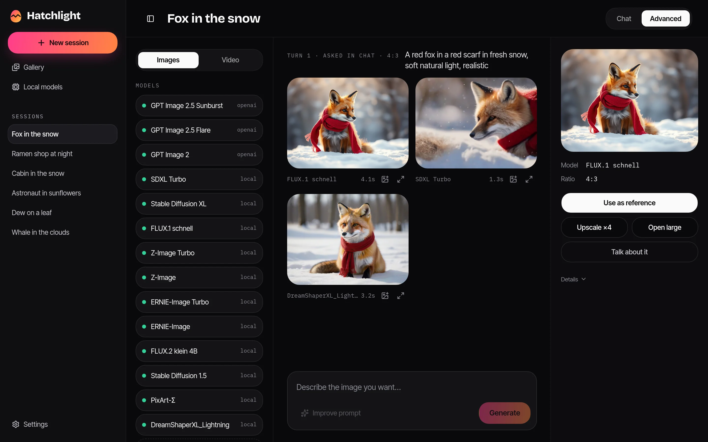
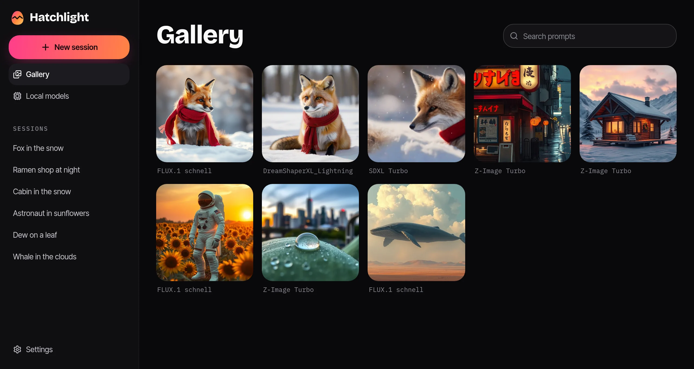
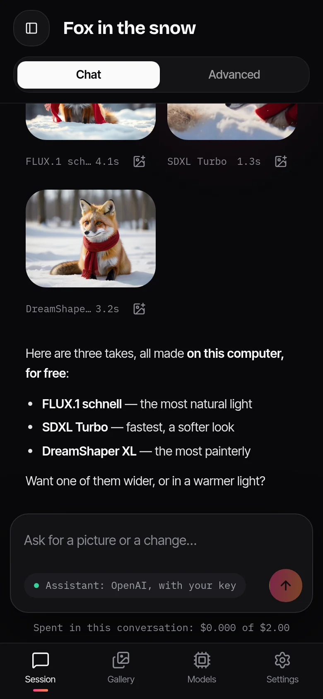

<p align="center">
  <picture>
    <source media="(prefers-color-scheme: dark)" srcset=".github/assets/logo-dark.svg">
    
  </picture>
</p>

<p align="center">
  <a href="https://github.com/hatchlight/hatchlight/releases/latest"><strong>Download</strong></a> ·
  <a href="https://hatchlight.app">Website</a> ·
  <a href="CONTRIBUTING.md">Contribute</a>
</p>

<p align="center">
  <a href="https://github.com/hatchlight/hatchlight/actions/workflows/ci.yml"></a>
  <a href="https://scorecard.dev/viewer/?uri=github.com/hatchlight/hatchlight"></a>
  <a href="https://www.bestpractices.dev/projects/16935"></a>
</p>



Make pictures and videos with many AI models, side by side. Run them on your
own graphics card for free, or use the services you already pay for with your
own keys. Open source, no account, no telemetry.

- **Compare models side by side.** One prompt goes to several models, and each
  result shows its time and cost.
- **Runs on your graphics card.** Hatchlight looks at your computer, picks the
  version of each model that fits it, downloads and checks the files, and runs
  them. Free, private, and offline once downloaded.
- **Your own keys, no middleman.** Cloud models are called straight from your
  computer with your key.

| SDXL Turbo                                                    | Stable Diffusion XL                                              | FLUX.1 schnell                                                      | Z-Image Turbo                                                       |
| ------------------------------------------------------------- | ---------------------------------------------------------------- | ------------------------------------------------------------------- | ------------------------------------------------------------------- |
|  |  |  |  |

_One prompt, four models, one RTX 4070 SUPER: "a red fox curled up in fresh
snow, soft morning light"._

## What it does

**Models on your computer.** 33 picture and video models in the catalog, many
of them in 16, 8 and 4 bit versions for different amounts of memory:

- pictures: SDXL Turbo, Stable Diffusion XL and 1.5, FLUX.1 schnell, FLUX.2
  klein, Z-Image, Qwen-Image, Chroma1, LongCat-Image, HiDream-O1, PixArt-Σ and
  more;
- editing by instruction: Qwen-Image-Edit, LongCat-Image-Edit, FLUX.2 klein
  and more;
- video: Wan 2.1 and Wan 2.2, from words or from a first frame;
- Real-ESRGAN to upscale ×4.

Pictures sharpen on screen while they form. A model stays loaded between
pictures, and several Hatchlight windows share one graphics card without
running out of memory.

**Models in the cloud, on your keys.** [fal](https://fal.ai),
[Replicate](https://replicate.com), [OpenRouter](https://openrouter.ai), OpenAI
and Google Gemini: FLUX, GPT Image, Nano Banana, Veo, Kling, Hailuo, Wan,
Seedream, Runway and more. Each result shows what it cost.

**Edit what you made.** Any picture can be the reference for the next prompt or
the first frame of a video. Change it a little or a lot, paint a mask and redraw
only that part, make room around it, crop, turn or flip it, or upscale it.

**Your own styles.** Load LoRAs and your own SDXL or SD 1.5 checkpoints, or
train an SDXL LoRA from your pictures: Hatchlight writes the captions, shows
sample pictures while it learns, and lets you keep an earlier step.

**An assistant.** Talk to it in the Chat view: "make the fox bigger", "now in
16:9, with FLUX". It picks models, writes the prompts and makes the pictures.
It can look at what came out and suggest a fix. The Advanced view
shows the same session with every setting. It asks before anything paid and
keeps to a spend limit. Write in your own language: each model gets the prompt
in the words it understands, and **Improve prompt** turns a short idea into a
detailed one.



**A gallery.** Every result is saved on your computer with the prompt and
settings that made it, and you can search it.

<p align="center">
  
  
</p>

The interface speaks English and Brazilian Portuguese, works on phones and
tablets as well as desktops, and can be used with the keyboard and a screen
reader. More languages are welcome: see [Translate](CONTRIBUTING.md#translate).

## Where it runs

| System               | The app | Models on your computer                              |
| -------------------- | ------- | ---------------------------------------------------- |
| Windows              | Yes     | NVIDIA (CUDA), AMD (ROCm), other cards (Vulkan), CPU |
| macOS, Apple Silicon | Yes     | Metal                                                |
| Linux                | Yes     | Not yet: cloud models only for now                   |
| macOS, Intel         | Yes     | Not yet: cloud models only for now                   |

Linux builds of the engines are in progress. Under WSL on Windows, the Windows
engines run, so models on your computer work there.

Some parts need more:

- training a LoRA needs Windows (or WSL) and an NVIDIA card with 12 GB of
  memory, and downloads about 6 GB of tools the first time;
- prompt translation and Improve prompt run on your computer on Windows and
  WSL, and the local assistant only in the Windows app; elsewhere they can use
  a cloud key instead.

## Install

**Desktop app:** download the installer for your system from the
[latest release](https://github.com/hatchlight/hatchlight/releases/latest). It
updates itself when a new version comes out.

The installers are not signed yet:

- **Windows:** if Windows says it protected your computer, choose **More
  info**, then **Run anyway**.
- **macOS:** if macOS says the app is damaged or cannot be opened, move it to
  Applications, run `xattr -cr /Applications/Hatchlight.app` in Terminal, and
  open it again.

**From source**, with [Bun](https://bun.sh) 1.4 or newer:

```sh
git clone https://github.com/hatchlight/hatchlight.git && cd hatchlight
bun install
bun run build
bun run start
```

This opens `http://localhost:4096`. The first screen walks you to a first
picture: download a model that runs on your computer, or paste an API key.

`bun run start --help` lists the options. Keys can also come from the
environment: `FAL_KEY`, `OPENAI_API_KEY`, `GEMINI_API_KEY`,
`REPLICATE_API_TOKEN`, `OPENROUTER_API_KEY`.

## Use it from the terminal

The same program makes pictures from the command line. From the Hatchlight
folder, `bun run start <command>`:

```sh
bun run start models                         # what can be used now
bun run start generate "a lighthouse at dusk" -m local/sdxl-turbo -o out/
bun run start generate "the same, at night" -r out/first.png --seed 7
bun run start upscale ast_… -o big.png
bun run start gallery lighthouse             # find what was made before
bun run start get ast_… -o lighthouse.png
bun run start generate --batch prompts.txt -o out/   # one prompt per line
bun run start chat "a poster of a lighthouse, then make it warmer"
```

`generate` waits and shows how each model is doing. With the app open, Ctrl+C
stops waiting while the job goes on, to follow with `status <session>`. Compare models by
repeating `-m`. Every command takes `--json` for scripts and has `--help`.
Like agents, it uses the Hatchlight already running or starts one for the
command, and only models on your computer unless you pass `--allow-paid`.

Setting up works from the terminal too:

```sh
bun run start doctor                 # the GPU, disk, models and what is missing
bun run start catalog                # models to download, and how they fit
bun run start install sdxl-turbo     # download one and wait until it is ready
bun run start keys set fal           # asks for the key without showing it
bun run start loras add style.safetensors
bun run start trainer install        # then train a LoRA from your pictures:
bun run start train photos/ --name "My dog" --trigger qzxdog --consent --samples out/
```

`bun run start completions zsh` (or `bash`, `fish`) prints tab completion for
your shell; its `--help` says where to put it.

## Use it from an AI agent

`hatchlight mcp` lets an agent that speaks the
[Model Context Protocol](https://modelcontextprotocol.io), such as Claude Code
or Claude Desktop, make pictures and videos with your models: list them,
generate and compare, redraw a picture, upscale it, and search and save from
your gallery. In the app, **Settings → Use with AI agents** connects Claude
Desktop for you and shows the command for Claude Code. From a source checkout:

```sh
claude mcp add hatchlight -- bun "$PWD/packages/cli/src/index.ts" mcp
```

It uses the Hatchlight already running, or starts one that stops with the
agent. By default only models on your computer are used, so it costs nothing;
`--allow-paid --spend-limit 5` also lets it use your cloud keys, up to $5 per
connection. Agents cannot install models: you do, in the app. See
`bun run start mcp --help`.

## Your data

Sessions, pictures and keys stay on your computer:

| System  | Directory                                                  |
| ------- | ---------------------------------------------------------- |
| Windows | `%APPDATA%\hatchlight`                                     |
| macOS   | `~/Library/Application Support/hatchlight`                 |
| Linux   | `$XDG_DATA_HOME/hatchlight` or `~/.local/share/hatchlight` |

On Windows, models and the LoRA trainer live in `%LOCALAPPDATA%\hatchlight`.
`HATCHLIGHT_DATA_DIR` or `--data-dir` puts the data elsewhere, and
`HATCHLIGHT_MODELS_DIR` moves only the models; the app can also move them to
another disk for you. Under WSL, models stay on the Windows side. The graphics
card driver reads them fastest there. Installs made before the rename to
Hatchlight keep using their `open-reel` folders and `OPEN_REEL_*` variables.

Keys are sent only to the provider they belong to and are never returned by
the API. The server listens on `127.0.0.1` only and refuses requests that do
not come from its own page, so other websites cannot use your keys. Nothing is
collected about you: Hatchlight has no telemetry. Besides the providers you
use, it only connects to the sites that host the models, the engines and their
sample pictures, to PyTorch's and Python's package sites when you install the
LoRA trainer, and to GitHub to check for updates.

## Responsible use

You are responsible for what you make with Hatchlight. Do not make pictures of
real people without their consent, and do not use it to deceive or harm
anyone. Training a LoRA asks you to confirm that you may use the pictures.

Each model has its own license, set by its authors. The Models screen shows
whether commercial use is allowed; SDXL Turbo, for example, is free for
commercial use only under a yearly revenue limit. Check the license before you
sell what you make.

## Built with

The interface is React with [shadcn/ui](https://ui.shadcn.com) on
[Base UI](https://base-ui.com) for accessible components,
[prompt-kit](https://www.prompt-kit.com) for the chat, and Tailwind CSS. The
server and the command line run on [Bun](https://bun.sh); the desktop app is
[Tauri](https://tauri.app).

## Contribute

Bug reports, translations, new providers and new local models are all
welcome. [CONTRIBUTING.md](CONTRIBUTING.md) explains how the project is laid
out, how to run it while developing, and what a pull request needs. Everyone
taking part follows the [code of conduct](CODE_OF_CONDUCT.md). To report a
security problem, see [SECURITY.md](SECURITY.md).

## License

[MIT](LICENSE). The models and engines the app downloads keep their own
licenses.
